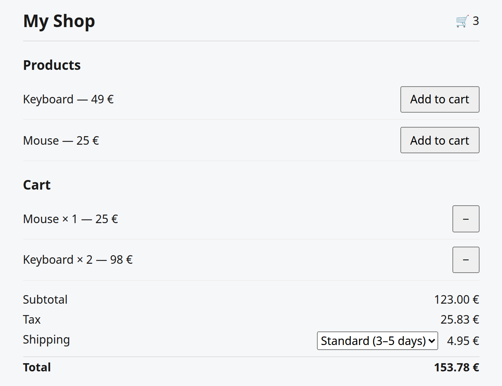

# Cart Shopping Context

Labs [RE08-1](https://albertprofe.dev/reactjs/rjslab8-1.html) and [RE08-2](https://albertprofe.dev/reactjs/rjslab8-2.html) on [albertprofe.dev](https://albertprofe.dev).

Five commits, one round each. The component tree and the data flow of every round are in [doc/skeleton-senior-cycle/README.md](doc/skeleton-senior-cycle/README.md).

| Iteration | State lives | Data flow | Files |
| --- | --- | --- | --- |
| 1 | Nowhere | None. Comments only | `src/App.jsx` |
| 2 | Two constants in `App` | Props down | `src/App.jsx` |
| 3 | `useState` in `App` | Handlers up. Totals derived | `src/App.jsx` |
| 4 | Reducer in `CartProvider` | `useCart` | `src/cart/`, `src/products/` |
| 5 | Same, plus `localStorage` | Same, plus tests | Same folders, plus `*.test.js` |

## Run it

```bash
npm install
npm test
npm run dev
```

## Iteration 5



The lab brief for the later work is [doc/exercise-cart-items-array.md](doc/exercise-cart-items-array.md).
