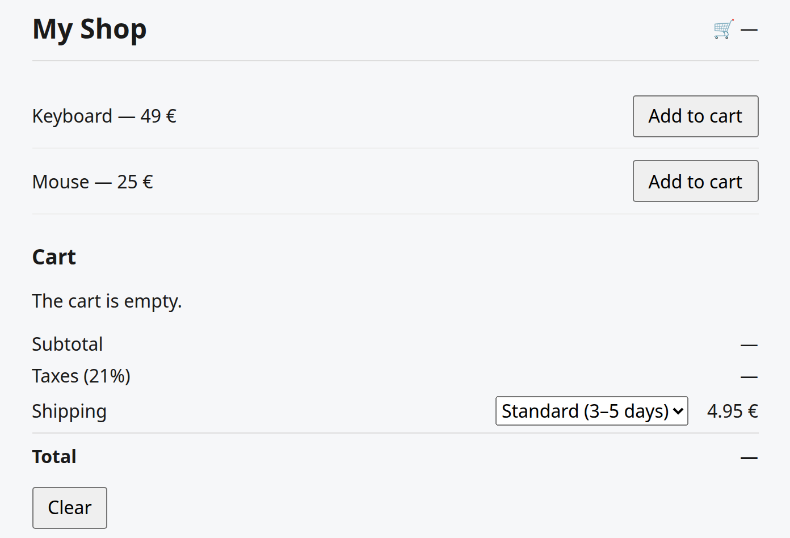

# Cart Shopping Context

Teaching skeleton for the shopping-cart labs [RE08-1](https://albertprofe.dev/reactjs/rjslab8-1.html) and [RE08-2](https://albertprofe.dev/reactjs/rjslab8-2.html) on [albertprofe.dev](https://albertprofe.dev).

The screen is in place: a header with a badge, a shelf of products, and a cart summary with tax and shipping. The cart rules are not. You fill those in.

Start with [doc/skeleton-senior-cycle-1/iteration-1-presence-representation-return.md](doc/skeleton-senior-cycle-1/iteration-1-presence-representation-return.md). That page is iteration 1 (initial). One round = three phases: Presence, Representation, Return.

1. **Presence** — the feature in your own words, the goal, the user flow, the unknowns. No typing.
2. **Representation** — the names, the component tree, the state shape, the actions, and the flow. Then the numbered `TODO` steps, one file at a time.
3. **Return** — run the real page and compare it with the first sketch.

The lab brief stays in [doc/exercise-cart-items-array.md](doc/exercise-cart-items-array.md). It is the lab for the finished screen. The goal sketch is [doc/images/expected-render-approx.png](doc/images/expected-render-approx.png).

## Iteration 1, as it runs



## Run it

```bash
npm install
npm run dev
```

The badge shows a dash and the money rows show dashes until the TODOs in `cartReducer`, `CartBadge`, and `CartSummary` are done. The shipping select already changes its own price, because that price is read from the fixture, not computed from the cart.

## What to notice before you type

- `Product` and `CartBadge` sit in different branches. They share the cart through `useCart`, not through props.
- A **product** is `{ id, name, price }`. An **item** is a cart line: the same fields plus `qty`.
- Subtotal, tax, and total are derived during render. Shipping is local state in `CartSummary`. Neither belongs in context.
