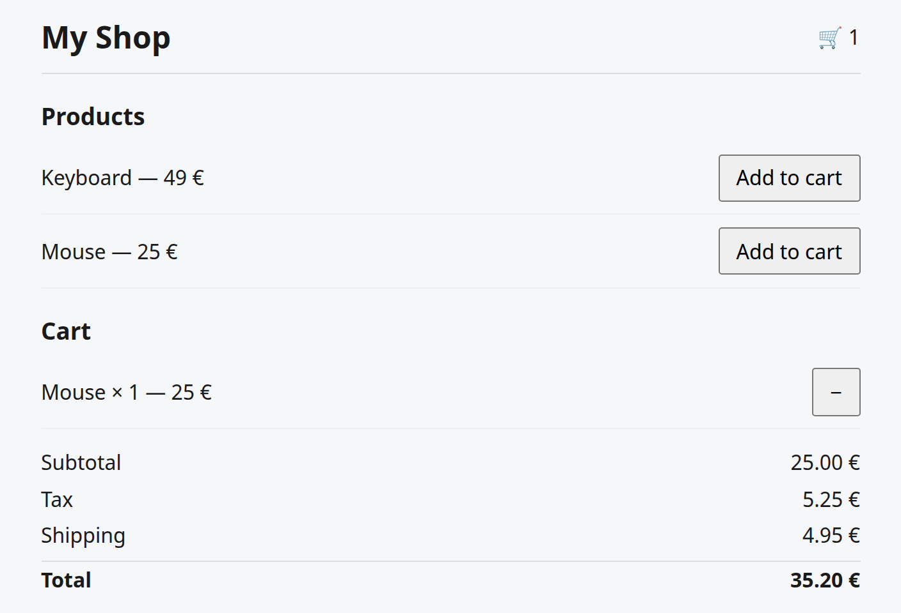

# Cart Shopping Context

Labs [RE08-1](https://albertprofe.dev/reactjs/rjslab8-1.html) and [RE08-2](https://albertprofe.dev/reactjs/rjslab8-2.html) on [albertprofe.dev](https://albertprofe.dev).

The rounds are in [doc/skeleton-senior-cycle/](doc/skeleton-senior-cycle/README.md). Iteration 1 paints the screen. Iteration 2 reads that screen from one `products` array and one list of lines.

## Run it

```bash
npm install
npm run dev
```

## Iteration 1



The lab brief for the later work is [doc/exercise-cart-items-array.md](doc/exercise-cart-items-array.md).
