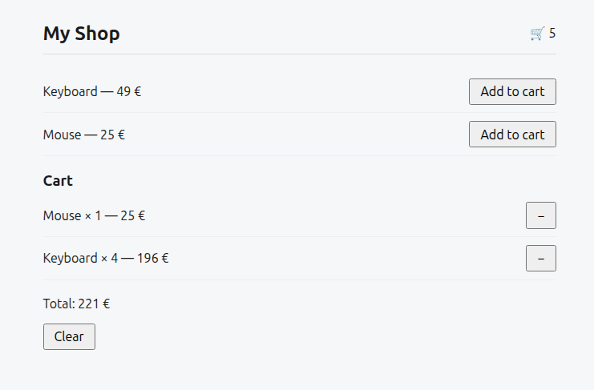

# Exercise: cart as an array — items, taxes and shipping

**Lab:** [RE08-1 — Cart Shopping Context](https://albertprofe.dev/reactjs/rjslab8-1.html)
**Base commit:** `471851d` — *v0.1: split cart context into folders*
**Playground:** [cart-context-visuals](https://albertprofe.dev/images/reactjs/docs/cart-context-visuals.html)

```bash
git checkout 471851d
```

## Introduction

At v0.1 the shop already shares state through `CartContext`: `CartProvider` owns
a `count`, and `CartBadge` (header) plus `Product` / `CartSummary` (main) read
or update it through the `useCart` hook — no prop drilling.

But a `count` is just a number. It cannot say *which* products are in the cart,
so it cannot compute a price. In this exercise you replace it with an array of
cart items, add a way to remove them, and calculate a final price with taxes
and a shipping method chosen from a `<select>` box.

**Current render (v0.1):** a counter that only goes up.

<p align="center">
  
</p>

**Expected render (approx):** priced products, a cart with quantities and a
`−` button per line, and a computed total.

<p align="center">
  
</p>

**Component tree:** context lets `CartBadge` and `CartSummary` consume the same
state from different branches of the tree.

<p align="center">
  
</p>

---

## Starting point

At v0.1 the context only stores a number:

```jsx
// src/context/CartContext.jsx
const [count, setCount] = useState(0);
// value = {{ count, setCount }}
```

- `Product` increments the counter with `setCount((c) => c + 1)`.
- `CartBadge` renders `🛒 {count}`.
- `CartSummary` shows the count and a **Clear** button.

## Task 1 — give products a price

Products need data, not just a name. In `ProductList`, pass `id`, `name` and
`price` to each `Product`:

```jsx
<Product id="keyboard" name="Keyboard" price={49} />
<Product id="mouse" name="Mouse" price={25} />
```

Update `Product` to receive the three props and render the name **and** the
price: `Keyboard — 49 €`.

## Task 2 — cart state becomes an array

In `CartContext`, replace `count` with `items`, an array of cart lines:

```js
// one line per product in the cart
{ id: "keyboard", name: "Keyboard", price: 49, qty: 4 }
```

Provide functions instead of a raw setter:

| Function             | Behaviour                                                  |
| -------------------- | ---------------------------------------------------------- |
| `addItem(product)`   | adds the product, or `qty + 1` if it is already there      |
| `removeItem(id)`     | `qty - 1` on that line; the line disappears when it hits 0 |
| `clearCart()`        | empties the array                                          |

```jsx
<CartContext.Provider value={{ items, addItem, removeItem, clearCart }}>
```

> Hint: `addItem` can use `items.find(...)` to check whether the product is
> already in the cart, then `map` to bump `qty` or spread a new line.
> `removeItem` can `map` to decrement and then `filter` out lines with
> `qty === 0`.

## Task 3 — update the consumers

Every consumer of `count`/`setCount` must switch to the new API:

- **`Product`** — the button calls `addItem({ id, name, price })`.
- **`CartBadge`** — show the total number of units:
  `items.reduce((sum, item) => sum + item.qty, 0)`.
- **`CartSummary`** — under a `Cart` heading, render one row per item in the
  format `Mouse × 1 — 25 €` with a `−` button calling `removeItem(item.id)`,
  a `Total: … €` line, and the existing **Clear** button now calling
  `clearCart()`.

## Task 4 — final price with taxes and shipping

Inside `CartSummary`, compute the amounts and let the user pick a shipping
method:

- **Subtotal** — `items.reduce((sum, i) => sum + i.price * i.qty, 0)`
- **Taxes** — 21 % VAT on the subtotal
- **Shipping** — a `<select>` with several prices:

```jsx
const SHIPPING = {
  pickup: { label: "Store pickup", price: 0 },
  standard: { label: "Standard (3–5 days)", price: 4.95 },
  express: { label: "Express (24 h)", price: 9.95 },
};
```

```jsx
const [shipping, setShipping] = useState("standard");
// ...
<select value={shipping} onChange={(e) => setShipping(e.target.value)}>
```

- **Total** — `subtotal + taxes + SHIPPING[shipping].price`

Show each line in the summary: subtotal, taxes, shipping, and a bold total,
all with `toFixed(2)`.

> Note: `shipping` lives in `CartSummary` with `useState`, not in the context.
> Only the cart items are shared state — the rest is local UI state.

## Checklist

- [ ] `CartContext` exposes `items`, `addItem`, `removeItem`, `clearCart`
- [ ] Adding the same product twice increments `qty`, not a duplicate line
- [ ] The `−` button decrements `qty` and removes the line at 0
- [ ] `CartBadge` shows total units and updates from the header
- [ ] **Clear** empties the cart
- [ ] The `<select>` switches shipping price and the total updates instantly
- [ ] Taxes (21 %), shipping and total are displayed with two decimals
- [ ] An empty cart shows subtotal/taxes/total of `0.00` without crashing

## Bonus

1. **+ button** per line to increase `qty` without going back to the list.
2. **`useReducer`**: move `addItem` / `removeItem` / `clearCart` into a
   `cartReducer.js` with `add`, `remove`, `clear` actions
   (this is what v0.2 does).
3. **Free shipping** over a threshold, e.g. standard shipping costs `0` when the
   subtotal is above `50`.

## What to notice

- The context value is now a rich API (`items` + functions), not just state.
  Consumers do not need to know *how* items are stored.
- Derived values (subtotal, taxes, total) are **computed during render**, never
  stored in state — they cannot go out of sync.
- `CartBadge` still knows nothing about prices: it only counts units.
