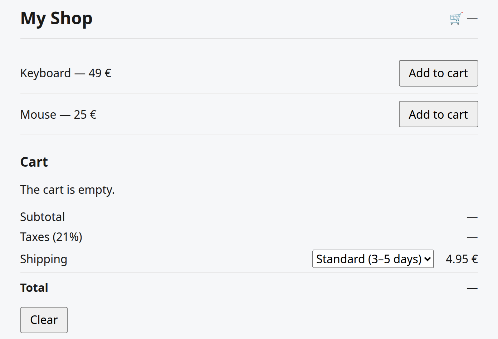
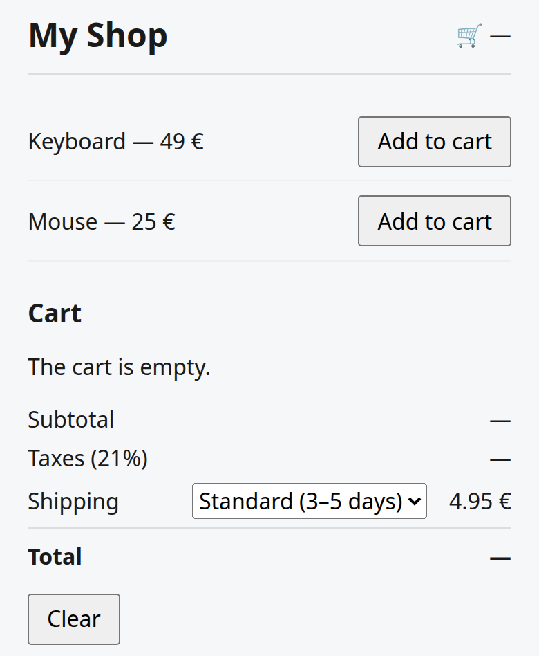
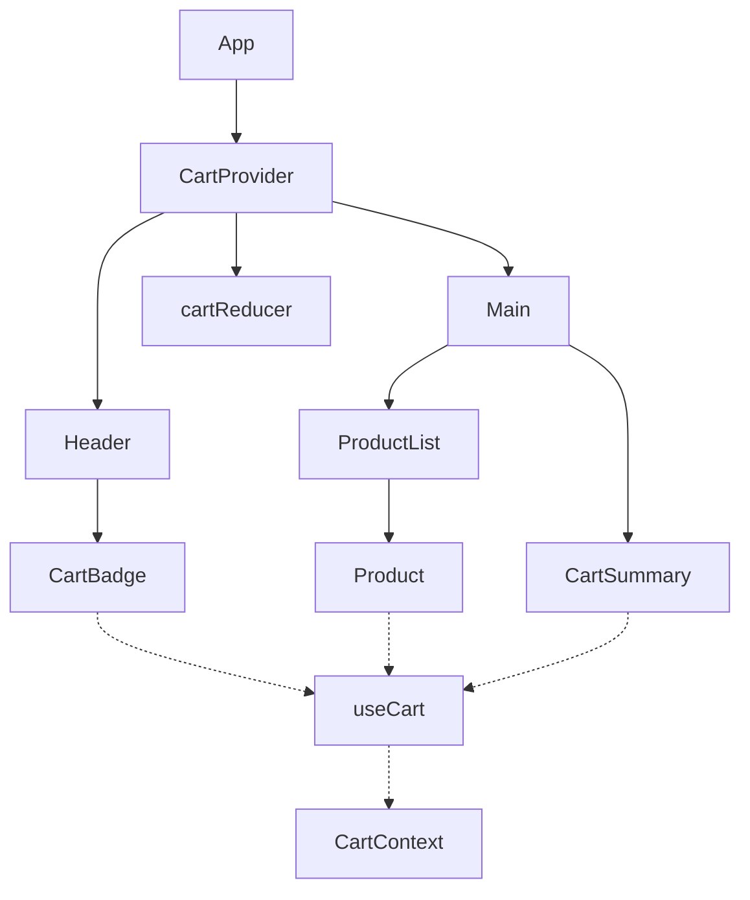
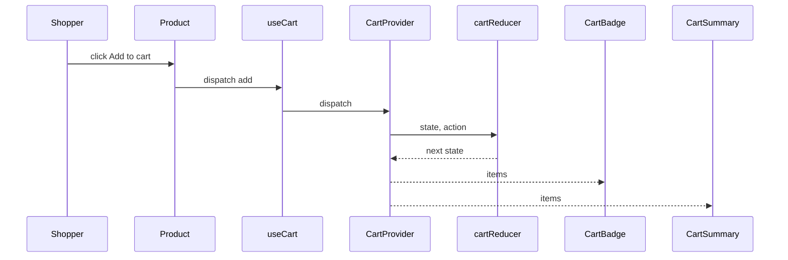

# Iteration 1 (initial) — Presence, Representation, Return

Iteration 1 is the initial round. One round = three phases: Presence, Representation, Return.

This page holds that round for the shopping cart, written down before the cart rules are filled in. The screen renders. The transitions and the money are still `TODO`.

A senior does not start by typing. See the whole feature, make one piece clear, build that piece, then look at the whole again. Names run through all three phases. A confusing name usually points to a confusing design, so the names below are part of the work, not decoration.

The lab brief is [exercise-cart-items-array.md](../exercise-cart-items-array.md). It stays in `doc/`, next to this folder, because it is the lab for the finished screen. The goal sketch is [expected-render-approx.png](../images/expected-render-approx.png).

## This iteration, as it runs

Desktop. The badge and the money rows are dashes. The cart is empty. Shipping already shows the price of the selected method.



Narrow window, 390px wide. Same column. The shipping select stays on one row.



## Presence

Broad attention. No typing yet.

### Feature, in our own words

A small shop lists products with prices. The shopper taps **Add to cart**. The same cart shows up in two places that do not pass props to each other: a badge in the header (how many units) and a summary under the shelf (which products, how many, and what it costs, including tax and a shipping method).

One sentence for the click: tap Add to cart, and the number in the header goes up.

### Goal

When it works, all of this is true:

- Adding a product raises the badge by the units added, not by one line.
- The summary shows that product as one line: name, qty, and the line price.
- Adding the same product again increases `qty`. It does not add a second line.
- Minus lowers `qty`. At 0 the line disappears.
- **Clear** empties the cart. The badge shows 0.
- The summary shows subtotal, 21% tax, the shipping method the shopper picked, and a total.
- An empty cart shows `0.00` and does not crash.
- The badge never shows a price. It counts units.

### User flow

1. The shopper sees **My Shop**, Keyboard at 49 €, Mouse at 25 €, an empty cart, and a badge that is not a price.
2. Tap **Add to cart** on Keyboard. The badge becomes 1. The summary shows Keyboard × 1 — 49 €.
3. Tap **Add to cart** on Keyboard again. The badge becomes 2. The same line shows qty 2 and 98 €.
4. Tap **−**. Qty goes down. At 0 the line is gone and the badge agrees.
5. Change the shipping select. The shipping price and the total change. The badge does not: it does not know about money.
6. Tap **Clear**. The badge is 0. The lines are gone. Subtotal, tax, and total are `0.00`. Shipping can still show the price of the method, because that price is not stored in the cart.

### Mockup

Two pictures, on purpose.

The goal sketch — lines with quantities and a plain total — is [expected-render-approx.png](../images/expected-render-approx.png) (`doc/images/expected-render-approx.png`). Tax and the shipping select are the rest of the same screen, under those lines. They are in the lab brief.

This iteration already draws that chrome. The dashes are the numbers you have not computed yet. The shipping row already reads the fixture, so the select is a real control. That running page is the picture at the top of this file, `render-iteration-1.png`.

### Unknowns

Name them before you commit to an implementation.

- A single count cannot say which product is in the cart, so it cannot price the cart. The cart is a list of lines.
- The same product twice is one line with a higher `qty`, not two lines.
- The badge and the summary live in different branches. Passing the cart down through `Header` and `Main` is prop drilling. The shared room is `CartProvider`.
- Subtotal, tax, and total are derived. If you store them, they drift away from the lines.
- Shipping is a choice on this screen, not a fact about the cart. It stays in `CartSummary`.
- The reducer must return a new state. It must not mutate the array it was given. StrictMode renders twice in development, which makes a mutation show up as a scrambled cart.

## Representation

Narrow attention. One piece at a time, then type only that piece.

### Names

| Name | What it names |
| --- | --- |
| `CartContext` | The room. The React context object. Not the data. |
| `CartProvider` | The component that owns the cart and offers it to the tree under it. |
| `useCart` | The door. Returns `{ items, dispatch }`. |
| `cartReducer` | Pure function `(state, action) => nextState`. |
| `initialCart` | The cart before any click: `{ items: [] }`. |
| `items` | The array of lines in the cart. |
| `item` | One line: `{ id, name, price, qty }`. |
| `product` | What the shop sells: `{ id, name, price }`. No `qty`. |
| `qty` | How many of that product are in the cart. |
| `PRODUCTS` | The catalog fixture. Not the cart. |
| `dispatch` | The only way to ask the reducer to change the cart. |
| `action` | `{ type, payload }`. |
| `CartBadge` | The unit count in the header. Not a price. |
| `CartSummary` | The reading of the cart: lines, money, shipping, clear. |
| `Product` | One row on the shelf, with **Add to cart**. |
| `ProductList` | The shelf. Maps `PRODUCTS` to `Product`. |
| `SHIPPING` | The delivery table. Not cart state. |
| `shippingMethod` | The selected key: `"pickup"`, `"standard"`, or `"express"`. Local to `CartSummary`. |
| `subtotal` | Sum of `price * qty`. Derived during render. |
| `tax` | 21% of the subtotal. Derived. |
| `total` | Subtotal + tax + shipping price. Derived. |

### Component tree



`Header`, `Main`, and `ProductList` do not call `useCart`. They do not need the cart. That is a name for a boundary, not an accident.

### State shape

Shared, in the provider:

```js
{
  items: [
    { id: "keyboard", name: "Keyboard", price: 49, qty: 2 }
  ]
}
```

Local to `CartSummary`, not in context:

```js
shippingMethod = "standard"
```

`TAX_RATE` is `0.21`. It is a named constant in `CartSummary`, not a piece of state.

### Actions

| `type` | `payload` | Next cart |
| --- | --- | --- |
| `"add"` | `{ id, name, price }` | If that `id` is already a line, `qty + 1`. Otherwise append `{ id, name, price, qty: 1 }`. |
| `"remove"` | `{ id }` | `qty - 1` on that line. Drop the line when `qty` reaches 0. |
| `"clear"` | none | `items` is `[]`. |

The buttons already speak these names. They do not change the cart until `cartReducer` answers. Start with the reducer.

### Flow



Money does not travel this path. `CartSummary` computes it from `items` while rendering. The select changes `shippingMethod` only, then the render reads `SHIPPING`.

### Where the TODOs are

Work top to bottom. Each file header has the same three notes — where it sits (Presence), why the name is that name, and what flows in and out — then numbered steps.

1. Read this page out loud. Do not type.
2. Read `src/data/products.js` and `src/data/shipping.js`. Check the shapes.
3. `src/context/cartReducer.js` — `"add"` first (the risky slice), then `"remove"`, then `"clear"`.
4. `src/CartBadge/CartBadge.jsx` — units, not lines, not euros.
5. `src/CartSummary/CartSummary.jsx` — line text, then subtotal, tax, total, two decimals.
6. Return. Run the real page and use the checklist below.

`Product` already dispatches `"add"` with `{ id, name, price }`. If the badge does not move, the bug is in the reducer, not in the button. Do not "fix" the button by storing a count in the row.

### Which parts need the tool

Context is for the cart, because two branches read it. Shipping does not need context. The catalog does not need context. Derived money does not need `useReducer`. Putting everything in one place because it works is how the tool becomes the goal.

## Return

Broad attention again. Put the piece back into the whole.

### Checklist

- [ ] `npm install` and `npm run dev`. Use the page, not only the code.
- [ ] Compare with the goal sketch `doc/images/expected-render-approx.png`, then with the tax and shipping lines in the lab brief. The picture at the top of this file is iteration 1 before those TODOs. Compare with the sketch, not with your diff.
- [ ] Add Keyboard twice. One line, qty 2, badge 2.
- [ ] Add Mouse. Badge 3. Two lines.
- [ ] Minus on Keyboard. Qty 1, then the line disappears. Badge agrees.
- [ ] **Clear** empties lines and the badge. It does not throw.
- [ ] The badge shows units. It stays correct when the shipping select changes.
- [ ] Subtotal, tax (21%), shipping, and total are visible with two decimals.
- [ ] Changing shipping changes the total and does not change the badge.
- [ ] An empty cart shows `0.00` for subtotal, tax, and total, and does not crash.
- [ ] No component under `Header` or `Main` receives the cart as props.
- [ ] Say the new unknowns. What did the code teach that this page did not?
- [ ] If a name or the tree was wrong, change the picture (this doc and the file header) in the same slice as the code.

### Before you call it done

Behaviour first. Then the whole, against the real world, not only the sketch.

- What happens if a product is missing `price`?
- What do you see if the reducer pushes into `state.items` instead of returning a new array? (Try it once, watch StrictMode, then put the copy back.)
- Who can dispatch? Anyone rendered under `CartProvider`. The hook throws outside it, on purpose.
- The next round starts from what you just saw, with a sharper first picture.

## File map

```
doc/skeleton-senior-cycle-1/iteration-1-presence-representation-return.md
doc/skeleton-senior-cycle-1/render-iteration-1.png
doc/skeleton-senior-cycle-1/render-iteration-1-mobile.png
doc/exercise-cart-items-array.md
src/main.jsx
src/App.jsx
src/App.css
src/index.css
src/data/products.js
src/data/shipping.js
src/context/CartContext.jsx
src/context/cartReducer.js
src/hooks/useCart.js
src/Header/Header.jsx
src/CartBadge/CartBadge.jsx
src/Main/Main.jsx
src/ProductList/ProductList.jsx
src/Product/Product.jsx
src/CartSummary/CartSummary.jsx
```
