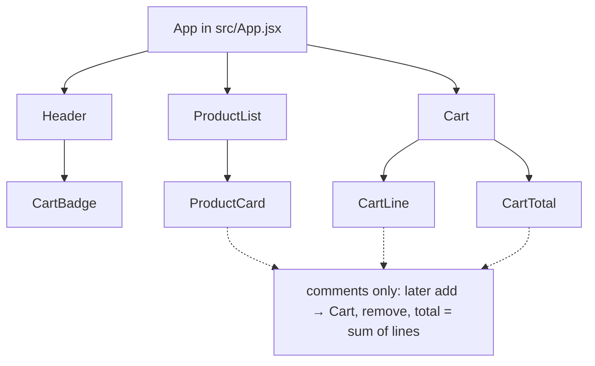
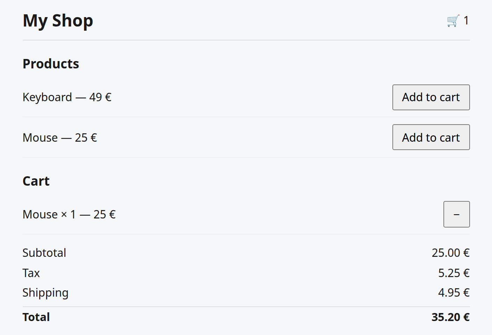
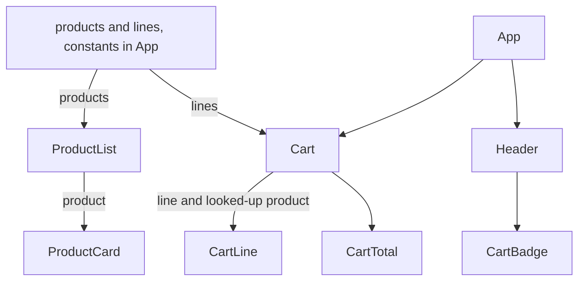
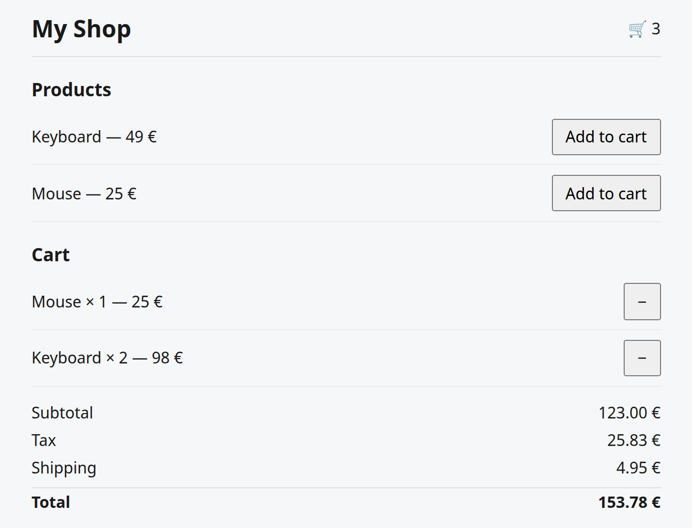
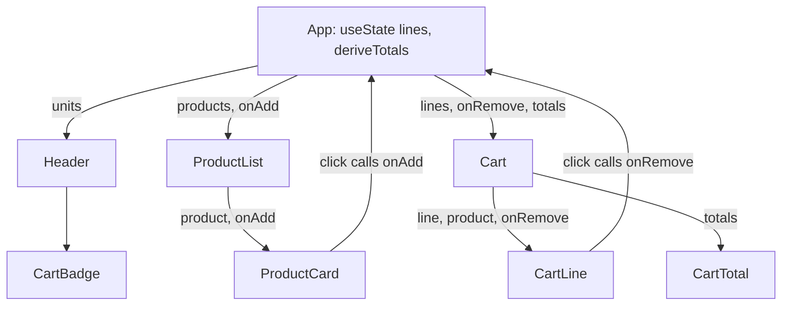
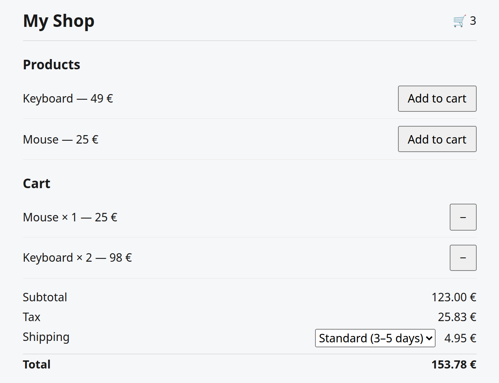
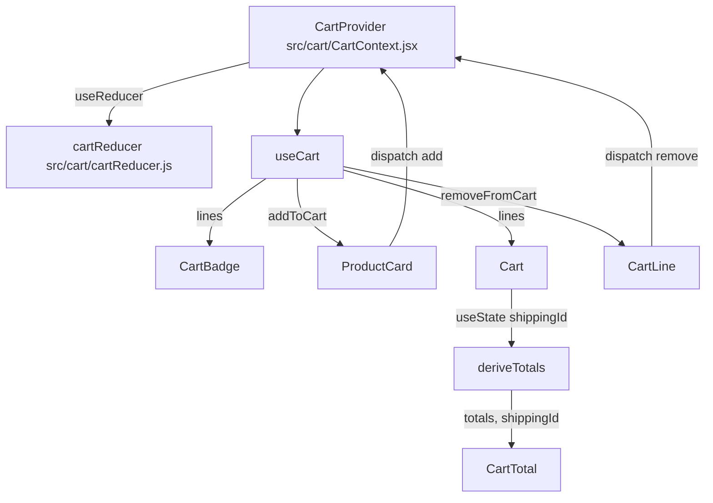
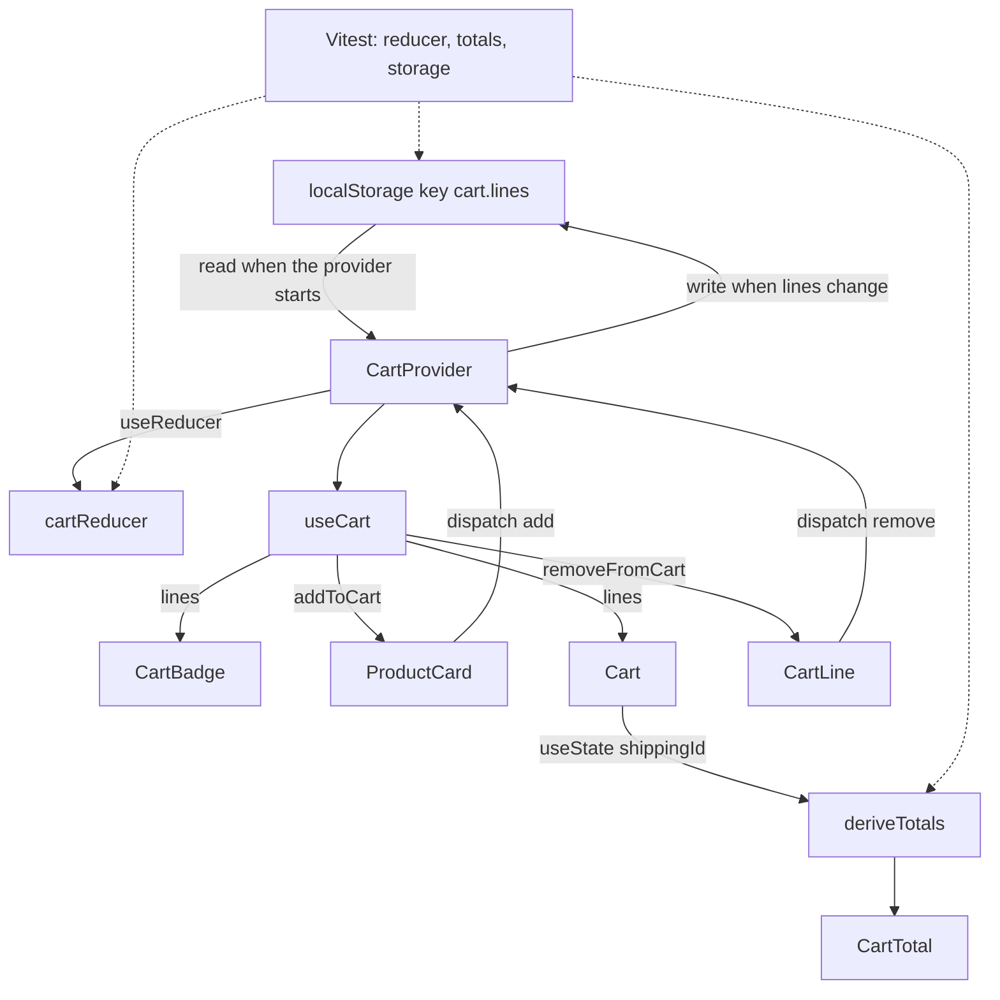

# Senior cycle — the shopping cart

One round is three phases: Presence, Representation, Return. Each iteration on this branch is one round, and one commit.

The first picture of the data is [`data-model-draft.json`](data-model-draft.json). Later rounds answer the questions that draft left open. The file itself stays the first picture.

The trees below are the components that commit actually rendered. Iterations 1–3 are functions inside `src/App.jsx`. `src/main.jsx` only mounts `App`.

## Comparison

| Iteration | State lives | Data flow | Files / folders | New idea |
| --- | --- | --- | --- | --- |
| 1 | Nowhere | None. Comments only | All components in `src/App.jsx` | Name every piece and paint the screen |
| 2 | Nowhere. Two constants in `App` | Data down, via props | Still `src/App.jsx` | One `products` array. A line keeps `productId` |
| 3 | `useState` for `lines` in `App` | Events up through handlers. Totals derived in `App` | Still `src/App.jsx` | A click changes the cart |
| 4 | `useReducer` in `CartProvider`. Shipping choice is `useState` in `Cart` | `useCart`. Add and remove dispatch. No cart props through parents | `src/cart/`, `src/products/`, plus `src/Header.jsx` and `src/format.js` | The cart is a room the tree can see. Shipping is a table |
| 5 | Same as 4, and `localStorage` key `cart.lines` | Same as 4, plus read on start and write when lines change. Tests call the pure functions | Same folders, plus `storage.js`, `*.test.js`, `vitest.config.js` | Prove the rules, and remember the cart |

## Iteration 1

[Doc](iteration-1-presence-representation-return.md) · [render](render-iteration-1.png)

<a href="render-iteration-1.png"></a>

Painted numbers. No props that carry the cart, no state, no handlers.

```
src/App.jsx
└── App
    ├── Header
    │   └── CartBadge                 🛒 1, written in the JSX
    ├── ProductList
    │   ├── ProductCard               Keyboard, as children
    │   └── ProductCard               Mouse, as children
    └── Cart
        ├── CartLine                  Mouse × 1, written in the JSX
        └── CartTotal                 25.00 / 5.25 / 4.95 / 35.20, written in the JSX
```



What changed: this is the first picture. The screen exists so the names can be looked at.

## Iteration 2

[Doc](iteration-2-presence-representation-return.md) · [render](render-iteration-2.png)

<a href="render-iteration-2.png"></a>

`products` and `lines` are constants at the top of `src/App.jsx`. `Cart` looks up the product. `CartBadge` and `CartTotal` are still painted.

```
src/App.jsx
└── App                                 products and lines constants
    ├── Header
    │   └── CartBadge                   still painted
    ├── ProductList                     prop: products
    │   └── ProductCard                 prop: product, one per row
    └── Cart                            prop: lines
        ├── CartLine                    props: line, product
        └── CartTotal                   still painted
```



What changed: the shelf and the line read one product. A price edit shows up in both. Clicks still do nothing.

## Iteration 3

[Doc](iteration-3-presence-representation-return.md) · [render](render-iteration-3.png)

<a href="render-iteration-3.png"></a>

`lines` are `useState` in `App`. `deriveTotals(lines)` runs during render. Handlers go down as props and the clicks call them.

```
src/App.jsx
└── App                                 useState lines, addToCart, removeFromCart, deriveTotals
    ├── Header                          prop: units
    │   └── CartBadge                   prop: units
    ├── ProductList                     props: products, onAdd
    │   └── ProductCard                 props: product, onAdd
    └── Cart                            props: lines, onRemove, totals
        ├── CartLine                    props: line, product, onRemove
        └── CartTotal                   prop: totals
```



What changed: Add and minus change the lines. The badge and the money are computed. The props have to walk through parents that do not use them.

## Iteration 4

[Doc](iteration-4-presence-representation-return.md) · [render](render-iteration-4.png)

<a href="render-iteration-4.png"></a>

`CartProvider` holds `useReducer(cartReducer)`. `Header`, `ProductList`, and `Cart` take no cart props. Shipping is `useState` inside `Cart`, and the options come from `src/cart/shipping.js`.

```
src/main.jsx
└── App                                 src/App.jsx
    └── CartProvider                    src/cart/CartContext.jsx
        ├── Header                      src/Header.jsx
        │   └── CartBadge               src/cart/CartBadge.jsx
        ├── ProductList                 src/products/ProductList.jsx
        │   └── ProductCard             src/products/ProductCard.jsx
        └── Cart                        src/cart/Cart.jsx
            ├── CartLine                src/cart/CartLine.jsx
            └── CartTotal               src/cart/CartTotal.jsx
```

Beside the tree, not rendered as components: `src/cart/context.js`, `src/cart/useCart.js`, `src/cart/cartReducer.js`, `src/cart/totals.js`, `src/cart/shipping.js`, `src/products/products.js`, `src/format.js`.



What changed: the same clicks, the same figures, and the parents no longer pass the cart down. `clear` is on the reducer and has no button.

## Iteration 5

[Doc](iteration-5-presence-representation-return.md) · [render](render-iteration-5.png)

<a href="render-iteration-5.png"></a>

The rendered tree is the iteration 4 tree. `CartProvider` now reads and writes `localStorage`. Tests sit next to the pure modules and do not render.

```
src/main.jsx
└── App                                 src/App.jsx
    └── CartProvider                    src/cart/CartContext.jsx
        │                               also src/cart/storage.js
        ├── Header                      src/Header.jsx
        │   └── CartBadge               src/cart/CartBadge.jsx
        ├── ProductList                 src/products/ProductList.jsx
        │   └── ProductCard             src/products/ProductCard.jsx
        └── Cart                        src/cart/Cart.jsx
            ├── CartLine                src/cart/CartLine.jsx
            └── CartTotal               src/cart/CartTotal.jsx
```

New files, not new components: `src/cart/storage.js`, `src/cart/storage.test.js`, `src/cart/cartReducer.test.js`, `src/cart/totals.test.js`, `vitest.config.js`. `findProduct` lives in `src/products/products.js` and is what `CartLine` uses.



What changed: a reload keeps the lines. The tests check a second add, a quantity that falls to zero, an empty cart, and prices that are not whole euros.
