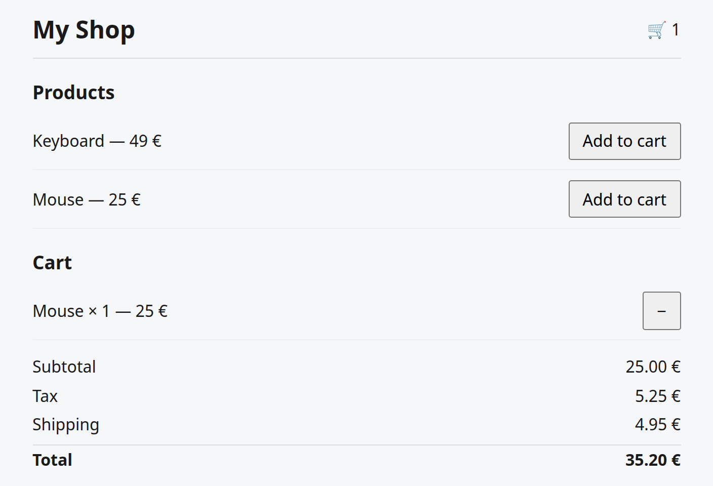

# Iteration 2 — data flows down

Iteration 2 is the second round. One round = three phases: Presence, Representation, Return.

The screen from iteration 1 is the picture we return to. This round does not add a behaviour. It makes the names point at one place.

## Presence

### Feature

The shop still shows Keyboard, Mouse, one cart line, and a hand-written total. What changes is where the words come from. There is one list of products. A cart line does not carry its own name or price. It carries the product's id, and the screen looks the product up.

### Goal of this round

Change a product's price in one place, and both the shelf and the cart line show the new price. Clicks still do nothing. The totals stay typed by hand, so we can see that they are the part that does not follow.

### What we settled

The open question from the draft was: does a line hold `productId` only, or a copy of `name` and `price`?

A line keeps `productId` and `qty`. Name and price live on the product. A copy on the line would go stale the moment the price changed, which is the bug this round is trying to make impossible.

[`data-model-draft.json`](data-model-draft.json) stays the first picture, copy and all. The code is the updated picture.

### Unknowns

- Totals are still the numbers from the draft, typed into `CartTotal` and `CartBadge`. A price change will not move them.
- The buttons are still painted. Add and remove have no function yet.
- Tax and shipping still have no rule. They are the same painted figures as iteration 1.

## Representation

Two constants at the top of `src/App.jsx`. No state. No folders.

```js
const products = [
  { id: "keyboard", name: "Keyboard", price: 49 },
  { id: "mouse", name: "Mouse", price: 25 },
];

const lines = [{ productId: "mouse", qty: 1 }];
```

`ProductList` receives `products` and maps one `ProductCard` per product. The card receives that product. `Cart` receives `lines`, finds the product for each `productId`, and passes both to `CartLine`.

```
App
├── products, lines          the only copies of the data
├── Header
│   └── CartBadge            still the painted 1
├── ProductList
│   └── ProductCard          product.name, product.price
└── Cart
    ├── CartLine             line.qty, product looked up
    └── CartTotal            still the painted 25.00 / 5.25 / 4.95 / 35.20
```

The flow comments stay where the clicks will go: `later: add → Cart`, `remove`, `total = sum(lines)`.

## Return

`npm run dev`. The page was compared with the iteration 1 render and with the sketch in the iteration 1 doc.



What agrees:

- Keyboard 49 €, Mouse 25 €, badge 1, Mouse × 1 — 25 €, subtotal 25.00, tax 5.25, shipping 4.95, total 35.20. Same screen as iteration 1.
- Clicking Add and the minus button changes nothing.

What the picture adds:

- Mouse's price is read from `products` on the shelf and again on the line. Changing that price to 30, then reloading, shows 30 € on the shelf and Mouse × 1 — 30 € in the cart. The badge stays 1 and the total stays 35.20. The price was put back to 25 before this commit. The totals are the part that did not follow.
- The repetition from iteration 1 is gone. Two cards, one component.

Next step: Iteration 3 — the cart comes alive. `lines` become state in `App`, add and remove are functions passed down as props, and the totals are computed from the lines instead of typed.
