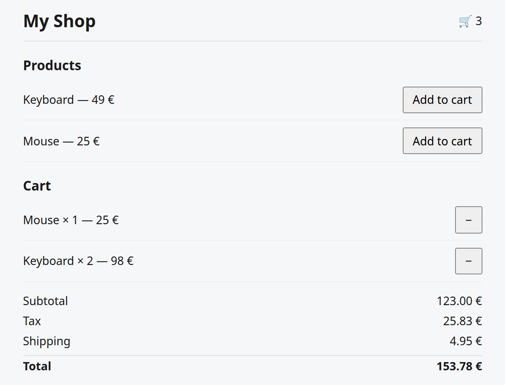

# Iteration 3 — the cart comes alive

Iteration 3 is the third round. One round = three phases: Presence, Representation, Return.

Iteration 2 could change a price and both places followed. It could not change a quantity. This round is the clicks.

## Presence

### Feature

The shopper taps Add to cart and the number in the header goes up. The same tap adds a line, or raises the quantity when the product is already there. Minus lowers the quantity and drops the line at zero. Subtotal, tax, shipping, and total are worked out from the lines while the screen is drawn. They are not kept beside the lines, or they would drift.

### Goal of this round

Add the keyboard twice, remove the mouse, and empty the cart, and be able to check every figure by hand. The lines live in `App`, because that is the closest component that can see both the badge and the cart.

### Rules written down before the code

- A line is still `{ productId, qty }`. Adding the same id raises `qty`. It does not push a second line.
- Tax is 21% of the subtotal. Shipping is 4.95 while the cart has a line, and 0 when it has none. Nothing is stored for either.
- Money is rounded to the cent at each step, so 98 × 0.21 is 20.58 and not a long float.

### Unknowns

- `addToCart` has to travel App → ProductList → ProductCard. `removeFromCart` travels App → Cart → CartLine. `units` travels App → Header → CartBadge. That is a long walk for three small facts. It will hurt as soon as another component needs the cart.
- Shipping is still one number. We do not yet know where a choice of method would live.

## Representation

`useState` in `App` holds `lines`. The first value is the line from the draft, mouse × 1, so the page opens on the same picture as iteration 2.

`addToCart(productId)` and `removeFromCart(productId)` are the only ways the lines change. They return a new array. They do not edit the old one.

`deriveTotals(lines)` runs during render and returns `{ units, subtotal, tax, shipping, total }`. `CartTotal` only prints what it is given.

```
App                          lines, addToCart, removeFromCart, totals
├── Header                   units
│   └── CartBadge
├── ProductList              products, onAdd
│   └── ProductCard          product, onAdd
└── Cart                     lines, onRemove, totals
    ├── CartLine             line, product, onRemove
    └── CartTotal            totals
```

Still one file. No context, no reducer.

## Return

`npm run dev`. The page opened on mouse × 1. Then the buttons were used.



Checked by hand, before the screenshot (mouse × 1, the opening picture):

- Subtotal 25.00. Tax 5.25. Shipping 4.95. Total 35.20. Badge 1. Same figures as the draft, now computed.

Then Add to cart on Keyboard, twice. The screenshot is this moment.

- Lines: Mouse × 1 — 25 €, Keyboard × 2 — 98 €.
- Units 1 + 2 = 3. Subtotal 25 + 98 = 123.00. Tax 123 × 0.21 = 25.83. Shipping 4.95. Total 123 + 25.83 + 4.95 = 153.78.

Then minus on Mouse, once.

- The mouse line is gone. Keyboard × 2 remains. Units 2. Subtotal 98.00. Tax 20.58. Shipping 4.95. Total 123.53.

Then minus on Keyboard, twice.

- The cart says it is empty. Subtotal, tax, shipping, and total are 0.00. The badge is 0. Shipping is not charged when there is nothing to ship.

What the picture adds:

- The props are the pain. Header does not use `units` except to hand it to the badge. ProductList does not use `onAdd` except to hand it to the card. The names are right, and the path is too long.
- A second add did not create a second keyboard line. That was the risky case, and it held.

Next step: Iteration 4 — take the cart out of the props. A context, a reducer with add, remove, and clear, and files split only where the seam is real. Shipping options come from data. The clicks should do what they do now.
