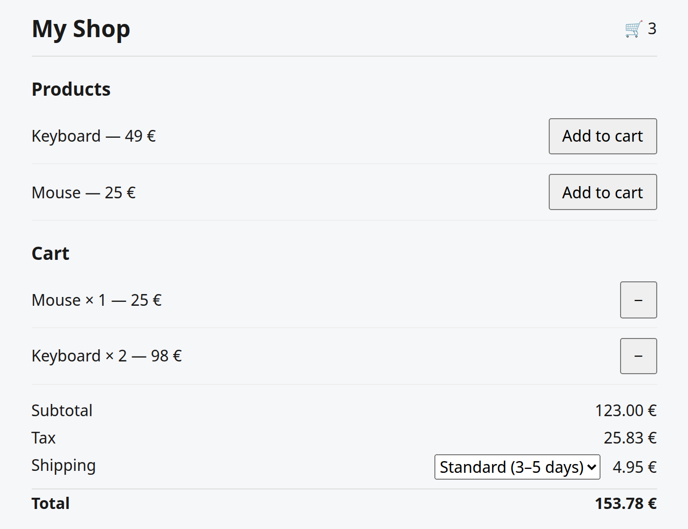

# Iteration 4 — the cart leaves the props

Iteration 4 is the fourth round. One round = three phases: Presence, Representation, Return.

No new shopping behaviour. The clicks from iteration 3 stay. This round moves the cart to where the whole tree can see it, and gives shipping a table instead of a bare number.

## Presence

### Feature

Add and minus still do what they did. The badge, the lines, and the totals still agree. What was wrong is the path: `App` handed `units` to `Header` only so `Header` could hand it to the badge, and the same for add and remove. The whole was getting lost in the passing.

Shipping was a single 4.95 written next to the tax rate. A choice of method needs a list, with a name and a price, and the screen should read that list.

### Goal of this round

Same click-through, same figures, with no cart props on `Header`, `ProductList`, or `CartLine`. Shipping options live in data. The default method is standard, 4.95, so a session that does not touch the select matches iteration 3.

### What stays

- A line is `{ productId, qty }`.
- Tax is 21% of the subtotal, rounded to the cent.
- An empty cart ships nothing. The price of the selected method is used only while there is a line.
- Totals are derived. They are not in the cart state. The selected method is local to `Cart`, because the badge does not care how the goods travel.

### Unknowns

- `clear` is a verb on the reducer and has no button. The screen from iteration 3 had no Clear. Adding one would be a new control, so it waits.
- Nothing remembers the cart if the page is reloaded.

## Representation

Before, everything was in `src/App.jsx`:

```
App
├── Header
│   └── CartBadge          units drilled in
├── ProductList
│   └── ProductCard        onAdd drilled in
└── Cart
    ├── CartLine           onRemove drilled in
    └── CartTotal          totals drilled in
```

After:

```
App
└── CartProvider           lines, addToCart, removeFromCart
    ├── Header
    │   └── CartBadge      useCart, sum of qty
    ├── ProductList
    │   └── ProductCard    useCart, addToCart
    └── Cart               shipping method, useState, local
        ├── CartLine       useCart, removeFromCart
        └── CartTotal      derived totals, select from shippingOptions
```

Files follow the seams. `src/products/` is the catalog and the shelf. `src/cart/` is the reducer, the context, the hook, the totals, the shipping table, and the cart screen. `src/Header.jsx` and `src/App.jsx` are the page. `src/format.js` is how a number becomes a euro string. There is no `components/` folder.

`cartReducer` answers `add`, `remove`, and `clear`. It returns a new `{ lines }` and does not edit the one it was given. `useCart` is the door. Outside the provider it throws, so a missing provider fails with a name.

`shippingOptions` is pickup 0, standard 4.95, express 9.95. `deriveTotals(lines, products, shippingPrice)` is the same rule as iteration 3, with the price passed in instead of a constant inside the function.

## Return

`npm run dev`. The same clicks as iteration 3.



What agrees:

- Opens on Mouse × 1, badge 1, total 35.20.
- Add Keyboard twice: Mouse × 1, Keyboard × 2, badge 3, subtotal 123.00, tax 25.83, shipping 4.95, total 153.78. Same figures as iteration 3.
- Minus on Mouse: Keyboard × 2, badge 2, total 123.53.
- Minus twice more: empty cart, badge 0, every money line 0.00.
- No console errors.

What the picture adds:

- The shipping row is a select. Express changes the shipping line to 9.95 and the total to 158.78. The badge stays 3. Standard puts 4.95 and 153.78 back. The method is not in the cart state.
- `Header` no longer takes a prop. `ProductList` no longer takes `onAdd`. The walk through the parents is gone.
- `clear` is in the reducer and unused by the screen. That is deliberate, and it is unfinished.

Next step: Iteration 5 — prove the reducer and the totals with tests, including cents, a quantity that falls to zero, and an empty cart. Remember the lines in the browser. Then read the names again and remove what the rounds left behind.
