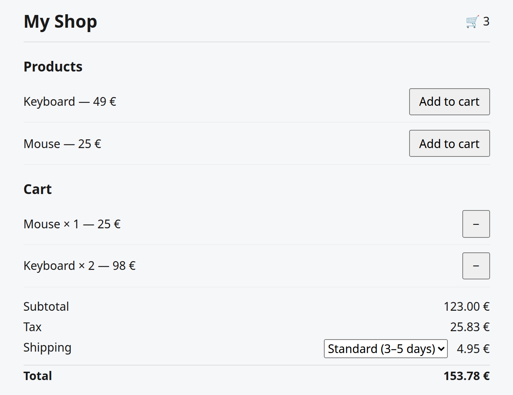

# Iteration 5 — prove it, and let it remember

Iteration 5 is the fifth round. One round = three phases: Presence, Representation, Return.

The clicks already work. This round asks whether they will still work tomorrow, and whether a reload throws the cart away.

## Presence

### Feature

The shopper adds, removes, and comes back to the same lines. The money is still derived, never stored. A test, not a person, checks the risky cases: the same product twice, a quantity that falls to zero, an empty cart, and a price that is not a whole euro.

### Goal of this round

`npm test` passes. A reload after Add keeps the lines and the badge. The names in the code still match the names in the first draft, except where a round already decided otherwise, and those decisions are written down.

### Against the first picture

[`data-model-draft.json`](data-model-draft.json) and the sketch in the iteration 1 doc are the picture this round is checked against.

The sketch showed Mouse × 1, a badge of 1, and a total of 35.20. Opening the page with an empty browser still does that. The total is no longer typed. It is 25 + 5.25 + 4.95.

The draft copied `name` and `price` onto the line. Iteration 2 kept only `productId`. That answer stands.

The draft stored `totals` on the cart. They are derived. Tax is 21% of the subtotal, rounded to the cent. Shipping is a row in `shippingOptions`. Standard is 4.95, which is why the first total still comes out at 35.20. An empty cart ships nothing, so its total is 0.00 rather than a delivery charge on nothing.

The draft did not mention a reload. The lines are now written to `localStorage` under `cart.lines`. A first visit, with nothing saved, still starts from the draft's mouse line.

## Representation

`cartReducer`, `deriveTotals`, and the storage helpers are pure. The tests call them with plain objects. They do not render React.

`CartProvider` reads the saved lines once, drops any id that is not in the catalog, and writes the lines again whenever they change. An empty list is a real saved cart. A missing key means "use the first line from the draft".

The lookup is one function, `findProduct`. The old inline `find` in the totals and in the line used two different parameter names for the same thing. They both say `product` now.

`clear` stays on the reducer and in the tests. The screen still has no Clear button, because none of the five sketches drew one. The action is not a leftover. The button would be a new control.

## Return

`npm test` — 18 tests, all passing. `npm run lint` and `npm run build` pass.

`npm run dev`. Add Keyboard twice, then reload.

What agrees with the run:

- Before the reload: Mouse × 1, Keyboard × 2, badge 3, subtotal 123.00, tax 25.83, shipping 4.95, total 153.78.
- `localStorage` held `[{"productId":"mouse","qty":1},{"productId":"keyboard","qty":2}]`.
- After the reload the screen was the same, including the badge and the total. No console errors.

What agrees with the first sketch, and what moved:

- The opening screen is still the sketch: My Shop, Keyboard 49, Mouse 25, one mouse line, badge 1, total 35.20.
- The 35.20 is now a sum. Change the mouse price and the line, the tax, and the total move together. In iteration 1 only the painted line would have been wrong, and the total would have stayed.
- The draft's copied name and price are not in the saved line. The line is `productId` and `qty`.
- The draft's stored totals are not saved. A reload recomputes them.
- Shipping is a choice. The sketch had a single shipping figure, which is the standard row.

The five rounds are the path from a painted screen to a cart that remembers. A later round starts from this picture. The open door is `clear`: the reducer and the tests already know it, and the screen still does not offer it.
